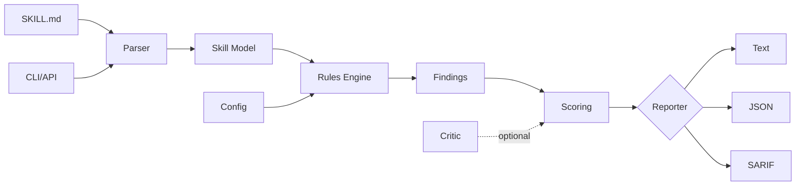

# skill-lint

[](https://www.python.org/downloads/)
[](https://opensource.org/licenses/MIT)

Offline linter and quality scorer for agent `SKILL.md` files (Claude/Cursor/Codex-style skills).

```
$ skill-lint examples/
================================================================================
SKILL-LINT REPORT
================================================================================

good-example
------------
Score: 95/100 (A)
Findings: 0 errors, 1 warnings, 0 info

examples/bad/SKILL.md
---------------------
Score: 68/100 (D)
Findings: 2 errors, 0 warnings, 1 info

================================================================================
SUMMARY
================================================================================
Total skills: 2 | Total findings: 4 | Average score: 81.5/100
```

## What is skill-lint?

`skill-lint` is a code quality tool for agent skills—the structured markdown files that define capabilities for AI coding agents. As AI-authored code becomes mainstream, automated validation of agent artifacts has become critical for code review efficiency.

### Why?

Inspired by [NVIDIA/SkillEvaluator](https://github.com/NVIDIA/SkillEvaluator), this tool addresses the growing need for automated quality checks on agent-generated documentation. With agent skills trending on GitHub (Nov 18, 2026) and [research showing AI coding agents have shifted the bottleneck to code review](https://complexdiscovery.com/harvard-researchers-find-ai-coding-agents-shifted-the-bottleneck-to-code-review/), `skill-lint` provides fast, offline validation with zero external dependencies.

**Note:** This is an independent implementation—no code was copied from NVIDIA/SkillEvaluator or any other source.

## Features

- ✅ **Parse SKILL.md files**: YAML frontmatter + markdown body
- 🔍 **11 linting rules**: frontmatter, naming, descriptions, structure, references, security
- 📊 **0-100 scoring**: weighted by severity with letter grades (A-F)
- 📝 **Multiple output formats**: text, JSON, SARIF
- 🌐 **FastAPI endpoint**: `POST /lint` for integration
- 🧠 **Optional LLM critique**: via environment variable (offline by default)
- 🔧 **Configurable**: `skill-lint.toml` for custom thresholds and disabled rules

## Installation

```bash
# Clone and install
git clone https://github.com/Abhi7230/trials.git
cd trials/daily-builds/2026-11-18-skill-lint
pip install -e .

# With development dependencies
pip install -e ".[dev]"
```

## Usage

### Command Line

```bash
# Lint a single file
skill-lint examples/good/SKILL.md

# Lint a directory
skill-lint examples/

# JSON output
skill-lint examples/ --format json

# SARIF output (for CI integration)
skill-lint examples/ --format sarif

# With minimum score requirement
skill-lint examples/ --min-score 80

# Use LLM critique (requires OPENAI_API_KEY or ANTHROPIC_API_KEY)
skill-lint examples/ --llm
```

### API Server

```bash
# Start the server
uvicorn skill_lint.api:app --reload

# Or with custom host/port
uvicorn skill_lint.api:app --host 0.0.0.0 --port 8000
```

**Endpoints:**

- `GET /health` - Health check
- `GET /rules` - List all linting rules
- `POST /lint` - Lint SKILL.md content

**Example:**

```bash
curl -X POST http://localhost:8000/lint \
  -H "Content-Type: application/json" \
  -d '{"content": "---\nname: test\ndescription: Test skill\n---\n\n# Test"}'
```

### Python API

```python
from pathlib import Path
from skill_lint import lint_path, lint_text
from skill_lint.config import Config

# Lint a directory
report = lint_path(Path("examples/"))

# Lint text content
config = Config()
report = lint_text("---\nname: test\n...", config=config)

# Access results
for skill in report.skills:
    score = report.scores[str(skill.path)]
    print(f"{skill.name}: {score.value}/100 ({score.grade})")
```

## Linting Rules

| Rule ID | Severity | Description |
|---------|----------|-------------|
| SL001 | ERROR | Missing or invalid YAML frontmatter |
| SL002 | WARNING | Name not kebab-case or doesn't match directory |
| SL003 | WARNING | Description length invalid (< 40 or > 500 chars) |
| SL004 | INFO | Description lacks "when to use" trigger phrase |
| SL005 | WARNING | Body too long (> 500 lines) |
| SL006 | ERROR | Referenced relative file doesn't exist |
| SL007 | WARNING | Broken heading hierarchy (skipped levels) |
| SL008 | INFO | High density of vague filler phrases ("etc.", "as needed") |
| SL009 | INFO | No concrete examples or code blocks |
| SL010 | ERROR | Possible secrets detected (API keys, tokens) |
| SL011 | ERROR | Duplicate skill names across directory |

## Configuration

Create a `skill-lint.toml` file:

```toml
# Disable specific rules
disabled_rules = ["SL008", "SL009"]

# Minimum score to pass (exit code 1 if below)
min_score = 70

# Customize thresholds
[thresholds]
description_min_length = 50
description_max_length = 600
body_max_lines = 500
filler_density_threshold = 0.1
```

## Example Output

**Text format:**

```
================================================================================
SKILL-LINT REPORT
================================================================================

good-example
------------
Score: 100/100 (A)
Findings: 0 errors, 0 warnings, 0 info

No issues found!

================================================================================
SUMMARY
================================================================================
Total skills: 1
Total findings: 0
Average score: 100.0/100
```

**JSON format:**

```json
{
  "version": "0.1.0",
  "results": [
    {
      "path": "examples/good/SKILL.md",
      "name": "good-example",
      "score": {
        "value": 100,
        "grade": "A",
        "findings_count": 0,
        "errors": 0,
        "warnings": 0,
        "info": 0
      },
      "findings": []
    }
  ],
  "summary": {
    "total_skills": 1,
    "total_findings": 0,
    "average_score": 100.0
  }
}
```

## Architecture



**Pure-core design:**
1. **Parser** → `Skill` dataclass
2. **Rules** → registry of small functions: `(Skill, Context) → [Finding]`
3. **Scoring** → weighted score calculation
4. **Reporters** → multiple output formats
5. **CLI/API** → thin adapters

## Development

```bash
# Install with dev dependencies
pip install -e ".[dev]"

# Run tests
pytest

# Type checking
mypy src/skill_lint

# Linting
ruff check src/ tests/

# Coverage report
pytest --cov=skill_lint --cov-report=html
```

## Testing

Tests require no API keys and run completely offline:

```bash
# Run all tests
pytest

# Specific test module
pytest tests/test_rules.py

# With coverage
pytest --cov=skill_lint --cov-report=term-missing
```

All tests use either the offline `HeuristicCritic` or a fake critic implementation.

## Credits

Inspired by [NVIDIA/SkillEvaluator](https://github.com/NVIDIA/SkillEvaluator). This is an independent implementation—no code was copied.

## License

MIT License - Copyright (c) 2026 Abhi Raj

See [LICENSE](LICENSE) for details.

## Contributing

This is a daily project built on Nov 18, 2026. Feel free to fork and extend!
