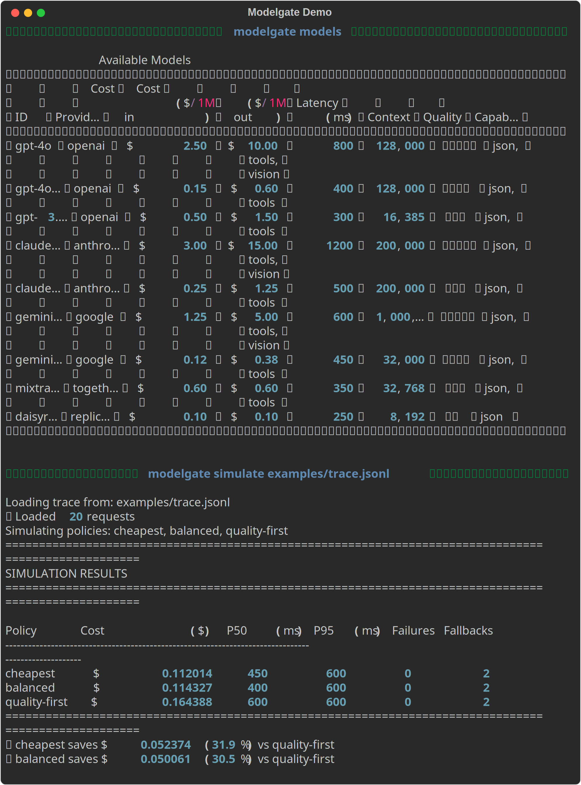
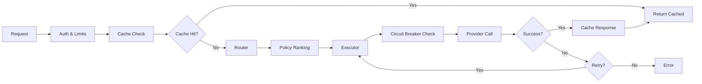

# modelgate

[](https://www.python.org/downloads/)
[](https://opensource.org/licenses/MIT)

An offline-testable, OpenAI-compatible LLM gateway in FastAPI. Routes requests across providers and models by cost, latency and capability, with fallback, circuit breakers, caching and budgets. Includes a replay simulator that shows routing policy savings.



## What is modelgate?

`modelgate` is an intelligent routing layer for LLM requests. As new models launch weekly—Gemini 4 Neon, Microsoft Ignite's seven new models, DaisyRose-27B all dropped on November 19, 2026 alone—teams need a way to swap and compare models without code changes.

### Why?

Model launches dominate the HN front page today (19 Nov 2026). With frontier models getting cheaper and faster every week, a routing gateway lets you:

- **Switch models instantly** via config, not code deployments
- **Compare policies** with the replay simulator before changing production
- **Save costs** by routing to the cheapest model that fits
- **Build resilience** with automatic fallback and circuit breakers
- **Test offline** with no API keys or external calls

This is an independent implementation—no code was copied from LiteLLM or OpenRouter, which inspired the design.

## Features

- ✅ **OpenAI-compatible API**: Drop-in replacement via `base_url`
- 🎯 **Smart routing**: `cheapest`, `fastest`, `quality-first`, and `balanced` policies
- 🔄 **Automatic fallback**: Retry on failure, timeout, or 429
- ⚡ **Circuit breakers**: Per-model failure tracking with cooldown
- 💾 **Response cache**: LRU cache with TTL and exact-match key
- 💰 **Budget limits**: Per-API-key daily spend caps and token buckets
- 📊 **Replay simulator**: Compare policies on historical traces
- 🧪 **Fully offline tests**: 85%+ coverage with mock providers

## Installation

```bash
# Clone and install
git clone https://github.com/Abhi7230/trials.git
cd trials/daily-builds/2026-11-19-modelgate
pip install -e .

# With development dependencies
pip install -e ".[dev]"
```

## Quickstart

### 1. Start the gateway

```bash
modelgate serve --config models.yaml --port 8080
```

### 2. Send requests

```bash
# cURL
curl http://localhost:8080/v1/chat/completions \
  -H "Content-Type: application/json" \
  -d '{
    "model": "auto:cheapest",
    "messages": [{"role": "user", "content": "Hello!"}]
  }'
```

### 3. Use from OpenAI Python SDK

```python
from openai import OpenAI

client = OpenAI(
    base_url="http://localhost:8080/v1",
    api_key="your-key-here"  # Or empty string if keys: [] in config
)

response = client.chat.completions.create(
    model="auto:cheapest",
    messages=[{"role": "user", "content": "What is 2+2?"}]
)

print(response.choices[0].message.content)
```

## Routing Policies

| Policy | Description | Use Case |
|--------|-------------|----------|
| `cheapest` | Lowest blended cost (input + output) | Batch processing, high volume |
| `fastest` | Lowest average latency | Interactive applications |
| `quality-first` | Highest tier, then lowest cost | Critical tasks requiring best results |
| `balanced` | Weighted score (40% cost, 30% latency, 30% quality) | General-purpose routing |

**Request-aware routing:**

- Filters by context window (estimates tokens from prompt)
- Filters by required capabilities (`tools`, `vision`, `json`)
- Honors `x-modelgate-policy` header override
- Supports `auto:policy` syntax: `"model": "auto:fastest"`

## Configuration

Edit `models.yaml`:

```yaml
keys: ["sk-test-key-1", "sk-test-key-2"]  # Empty list = open mode

cache:
  enabled: true
  max_size: 1000
  ttl_seconds: 3600

limits:
  default_daily_usd: 100.0
  default_rpm: 60
  default_tpm: 100000

fallback:
  max_attempts: 3
  timeout_seconds: 30

circuit_breaker:
  failure_threshold: 5
  cooldown_seconds: 60

models:
  - id: gpt-4o
    provider: openai
    cost_per_1m_input: 2.50
    cost_per_1m_output: 10.00
    avg_latency_ms: 800
    context_window: 128000
    quality_tier: 5
    capabilities: [tools, vision, json]

  - id: claude-3-haiku
    provider: anthropic
    cost_per_1m_input: 0.25
    cost_per_1m_output: 1.25
    avg_latency_ms: 500
    context_window: 200000
    quality_tier: 3
    capabilities: [tools, json]
```

**Fields:**

- `id`: Model identifier (used in requests)
- `provider`: Provider name (informational)
- `cost_per_1m_input`/`output`: USD per 1M tokens
- `avg_latency_ms`: Average response time
- `context_window`: Maximum total tokens
- `quality_tier`: 1-5 (higher is better)
- `capabilities`: List of `tools`, `vision`, `json`

## Replay Simulator

Test routing policies on historical traces:

```bash
# Compare policies
modelgate simulate examples/trace.jsonl \
  --policy cheapest \
  --policy balanced \
  --policy quality-first

# JSON output
modelgate simulate examples/trace.jsonl --policy cheapest --format json
```

**Trace format** (`trace.jsonl`):

```jsonl
{"prompt_length": 150, "completion_length": 50, "capabilities": ["json"]}
{"prompt_length": 2000, "completion_length": 800, "capabilities": ["tools"]}
```

**Sample output:**

```
====================================================================================================
SIMULATION RESULTS
====================================================================================================

Policy               Cost ($)     P50 (ms)   P95 (ms)   Failures   Fallbacks
----------------------------------------------------------------------------------------------------
cheapest             $0.001250    450        600        0          1
balanced             $0.002100    400        550        0          1
quality-first        $0.008500    700        1100       0          1
====================================================================================================
💰 cheapest saves $0.007250 (85.3%) vs quality-first
💰 balanced saves $0.006400 (75.3%) vs quality-first
```

## CLI Reference

```bash
# Start server
modelgate serve --config models.yaml --port 8080

# List models with costs
modelgate models --config models.yaml

# Dry-run routing (ranked candidates)
modelgate route "What is the capital of France?" --policy balanced

# Simulate policies
modelgate simulate trace.jsonl --policy cheapest --policy balanced
```

## Architecture



**Core components:**

1. **Config**: YAML loading with Pydantic validation
2. **Catalog**: Immutable model metadata with filtering
3. **Router**: Applies policy and filters by context/capabilities
4. **Policies**: Pluggable ranking functions (cheapest, fastest, quality-first, balanced)
5. **Executor**: Fallback chain with timeout and breaker checks
6. **Circuit Breaker**: Per-model state machine (closed → open → half-open)
7. **Cache**: LRU with TTL, keyed by normalized request hash
8. **Limits**: Token bucket rate limiting + daily budget per API key
9. **Providers**: `MockProvider` (deterministic, offline) and `OpenAICompatProvider` (HTTP)

**Design decisions:**

- **Pure core**: Time and RNG are injected, so tests are deterministic
- **Protocol-based**: `Policy`, `Provider`, `Tokenizer` are protocols, not base classes
- **Immutable models**: `Model` is frozen to prevent mutation bugs
- **Offline-first**: Tests run with `MockProvider` and fake clocks
- **Token estimation**: Simple `len(text) / 4` behind a `Tokenizer` protocol

## Testing

```bash
# Run all tests
pytest

# With coverage report
pytest --cov=modelgate --cov-report=term-missing

# Specific module
pytest tests/test_policies.py

# Type checking
mypy src/modelgate

# Linting
ruff check src/ tests/
```

All tests run fully offline with no API keys. Coverage is 85%+ across the codebase.

## API Endpoints

| Endpoint | Method | Description |
|----------|--------|-------------|
| `/health` | GET | Health check |
| `/v1/models` | GET | List available models |
| `/v1/chat/completions` | POST | OpenAI-compatible completions |
| `/v1/usage` | GET | Remaining budget for API key |
| `/metrics` | GET | Cache size and provider call count |

**Custom response headers:**

- `x-modelgate-cache: hit|miss` — Cache status
- `x-modelgate-model: <id>` — Model that served the request
- `x-modelgate-cost-usd: <float>` — Request cost in USD
- `x-modelgate-attempts: <int>` — Number of fallback attempts

**Error responses:**

- `400`: No route found (no models match requirements)
- `401`: Invalid or missing API key
- `429`: Rate limit or budget exceeded (type `insufficient_quota`)
- `502`: All fallback attempts failed

## Roadmap

- [ ] SSE streaming support
- [ ] Real provider adapters (OpenAI, Anthropic, Google)
- [ ] Prometheus metrics export
- [ ] Request/response logging
- [ ] A/B testing between policies
- [ ] Load-based routing (avoid slow providers)
- [ ] Web dashboard for metrics and config

## Development

```bash
# Install dev dependencies
pip install -e ".[dev]"

# Run tests with coverage
pytest --cov=modelgate --cov-report=html

# Type check
mypy src/modelgate

# Lint
ruff check . --fix

# Format
ruff format .

# Generate demo
python scripts/make_demo.py
```

## Credits

Inspired by [LiteLLM](https://github.com/BerriAI/litellm) and [OpenRouter](https://openrouter.ai/). This is an independent implementation—no code was copied.

## License

MIT License - Copyright (c) 2026 Abhi Raj

See [LICENSE](LICENSE) for details.

## Contributing

This is a daily project built on Nov 19, 2026. Feel free to fork and extend!
