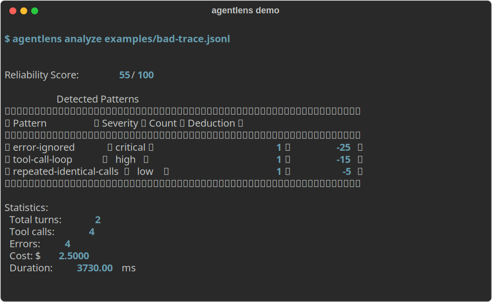
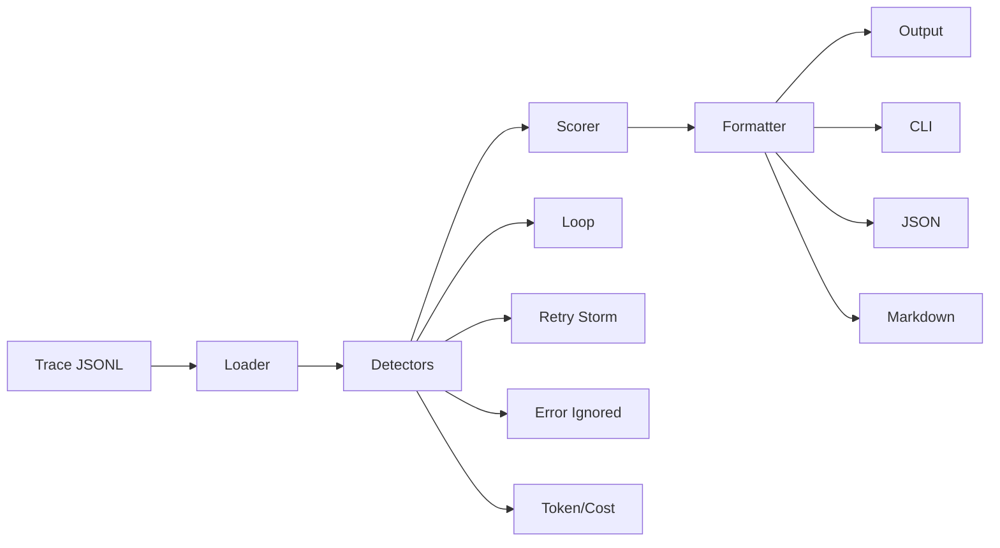

# agentlens - AI Agent Reliability Analyzer

[](https://www.python.org/downloads/)
[](https://opensource.org/licenses/MIT)

An offline analyzer for AI agent run traces. Detects reliability failure patterns, computes a 0-100 reliability score, and outputs rich CLI, JSON, or Markdown reports. Includes a FastAPI service and CI gate exit codes.



## What is agentlens?

`agentlens` analyzes JSONL traces of AI agent runs—messages, tool calls, and tool results—to identify reliability anti-patterns like infinite loops, ignored errors, and retry storms. It's designed for offline analysis with no external dependencies.

### Why?

As of November 20, 2026, [GitHub Trending](https://github.com/trending) features **Tracer-Cloud/opensre** (agent reliability monitoring), **obra/superpowers**, and **HKUDS/CLI-Anything**. As agents move into production, analyzing their reliability after the fact becomes critical for debugging and continuous improvement.

This tool provides:

- ✅ **Offline analysis**: No API keys or external calls required
- 🎯 **Pattern detection**: 8 built-in reliability anti-patterns
- 📊 **Rich output**: CLI, JSON, and Markdown reports
- 🚦 **CI integration**: Exit codes for quality gates
- 🔌 **API service**: FastAPI endpoint for programmatic access

## Features

- **8 reliability patterns**: Tool loops, error ignoring, retry storms, hallucinated tools, token/cost blowups, latency outliers
- **Dual trace formats**: Native and OpenAI-style schemas
- **Pluggable detectors**: Registry-based architecture for custom patterns
- **Configurable thresholds**: Adjust limits per detector
- **Score-based gating**: `--fail-under N` for CI pipelines
- **100% offline tests**: Fully tested with 85%+ coverage

## Installation

```bash
# Clone and install
git clone https://github.com/Abhi7230/trials.git
cd trials/daily-builds/2026-11-20-agentlens
pip install -e .

# With development dependencies
pip install -e ".[dev]"
```

## Quickstart

### Analyze a trace

```bash
agentlens analyze examples/bad-trace.jsonl
```

### Use in CI

```yaml
# .github/workflows/agent-quality.yml
- name: Check agent reliability
  run: |
    agentlens analyze traces/latest.jsonl --fail-under 70
```

### Query via API

```bash
# Start the service
agentlens serve --port 8080

# Analyze via curl
curl -X POST http://localhost:8080/analyze \
  -H "Content-Type: application/json" \
  -d '{
    "trace": [
      {"timestamp": "2026-11-20T10:00:00Z", "type": "message", "role": "user", "content": "Hello"}
    ],
    "options": {"fail_under": 70}
  }'
```

## Trace Formats

agentlens accepts two trace schemas:

### Native Format

```jsonl
{"timestamp":"2026-11-20T10:00:00Z","type":"message","role":"user","content":"Deploy service"}
{"timestamp":"2026-11-20T10:00:01Z","type":"tool_call","role":"assistant","tool_call_id":"call_1","tool_name":"deploy","tool_args":{"env":"prod"},"cost_usd":0.001,"latency_ms":200,"prompt_tokens":50,"completion_tokens":20}
{"timestamp":"2026-11-20T10:00:02Z","type":"tool_result","role":"tool","tool_call_id":"call_1","content":"Success"}
{"timestamp":"2026-11-20T10:00:03Z","type":"message","role":"assistant","content":"Deployed"}
```

**Fields:**
- `timestamp`: ISO 8601 timestamp
- `type`: `"message"` | `"tool_call"` | `"tool_result"`
- `role`: `"user"` | `"assistant"` | `"tool"`
- `content`: Message text or tool result
- `tool_call_id`: Unique ID for tool call/result pairing
- `tool_name`: Name of the tool
- `tool_args`: JSON object of arguments
- `error`: Error message (for failed tool results)
- `cost_usd`: Cost in USD (optional)
- `latency_ms`: Latency in milliseconds (optional)
- `prompt_tokens`, `completion_tokens`: Token counts (optional)

### OpenAI Format

```jsonl
{"role":"user","content":"Check weather","timestamp":"2026-11-20T10:00:00Z"}
{"role":"assistant","tool_calls":[{"id":"call_abc","type":"function","function":{"name":"get_weather","arguments":"{\"city\":\"SF\"}"}}],"timestamp":"2026-11-20T10:00:01Z"}
{"role":"tool","tool_call_id":"call_abc","content":"Sunny, 72F","timestamp":"2026-11-20T10:00:02Z"}
{"role":"assistant","content":"The weather is sunny and 72F","timestamp":"2026-11-20T10:00:03Z"}
```

agentlens automatically detects the format. Mixing formats in one file raises a `ValueError`.

## Reliability Patterns

| Pattern | Description | Severity | Deduction |
|---------|-------------|----------|-----------|
| `tool-call-loop` | Same tool called 4+ times with identical/near-identical args | High | -15 |
| `repeated-identical-calls` | Same tool+args combination appears >2 times anywhere | Low | -5 |
| `retry-storm` | 5+ consecutive tool errors without success | High | -20 |
| `error-ignored` | Tool error followed by success claim ("done", "success", "completed") without retry | Critical | -25 |
| `hallucinated-tool` | Tool name not in catalog (requires `--tools catalog.json`) | High | -15 |
| `token-blowup` | Cumulative tokens >100k OR single turn >50k | Medium | -10 |
| `cost-blowup` | Cumulative cost >$5.00 | Medium | -10 |
| `latency-outlier` | Single turn >10s OR P95 >5s | Low | -5 |

**Notes:**
- Fuzzy argument matching uses `difflib.SequenceMatcher` with 0.9 similarity threshold
- Loop streak resets when a non-tool-call event (other than its tool_result) appears
- Thresholds are configurable via detector `config` parameter

## Scoring

The reliability score starts at **100** and deducts points for each detected pattern:

1. Patterns are sorted by severity: **critical** → **high** → **medium** → **low**
2. Deductions are applied in order
3. Score is floored at **0**

Example:
- Perfect trace: **100**
- One loop: **85** (100 - 15)
- Loop + error-ignored: **60** (100 - 25 - 15)

Use `--fail-under N` to gate CI pipelines.

## Configuration

Pass detector-specific config via the API or programmatically:

```python
from agentlens.scorer import analyze_trace
from agentlens.trace_loader import load_trace

events = load_trace("trace.jsonl")
result = analyze_trace(events, config={
    "loop_min_streak": 5,         # Require 5+ calls for loop
    "retry_storm_min_errors": 3,  # 3+ errors trigger storm
    "token_cumulative_limit": 50_000,
    "cost_limit_usd": 10.0,
    "tools_catalog": "catalog.json"
})
```

## Architecture



**Components:**

1. **Loader**: Parses JSONL, detects schema, normalizes to `TraceEvent`
2. **Detectors**: Pluggable pattern detectors registered at import
3. **Scorer**: Runs all detectors, computes score, aggregates stats
4. **Formatters**: Rich CLI (color-coded), JSON, and Markdown outputs

**Design decisions:**

- **Offline-first**: No network calls, all tests use synthetic fixtures
- **Protocol-based**: `Detector` is a protocol, not a base class
- **Registry pattern**: Detectors auto-register via `@register` decorator
- **Immutable models**: Pydantic models for type safety
- **Fuzzy matching**: `difflib.SequenceMatcher` instead of python-Levenshtein (stdlib only)

## CLI Reference

```bash
# Analyze a trace
agentlens analyze trace.jsonl [--format cli|json|markdown] [--output FILE] \
  [--tools catalog.json] [--fail-under N] [--verbose]

# List detection rules
agentlens rules [--format table|json]

# Start API service
agentlens serve [--port 8080]
```

## API Endpoints

| Endpoint | Method | Description |
|----------|--------|-------------|
| `/analyze` | POST | Analyze trace and return score + patterns |
| `/rules` | GET | List all detection rules |
| `/health` | GET | Health check |
| `/metrics` | GET | Service metrics (analysis count, avg score) |

**POST /analyze** body:

```json
{
  "trace": [
    {"timestamp": "...", "type": "message", "role": "user", "content": "..."}
  ],
  "options": {
    "fail_under": 70,
    "tools_catalog": "catalog.json"
  }
}
```

**Response:**

```json
{
  "score": 75,
  "passed": true,
  "patterns": [
    {
      "type": "tool-call-loop",
      "severity": "high",
      "count": 1,
      "deduction": 15,
      "instances": [...]
    }
  ],
  "stats": {
    "total_turns": 10,
    "tool_calls": 8,
    "errors": 2,
    "cost_usd": 0.05,
    "duration_ms": 1234.56
  }
}
```

## Testing

```bash
# Run all tests
pytest

# With coverage
pytest --cov=agentlens --cov-report=term-missing

# Specific module
pytest tests/test_detectors.py

# Lint
ruff check .
```

All tests run fully offline with synthetic fixtures. Coverage is 85%+.

## Roadmap

- [ ] **Streaming support**: Analyze traces as they're written
- [ ] **OpenTelemetry import**: Parse OTel GenAI span exports
- [ ] **Custom pattern DSL**: User-defined patterns in YAML/JSON
- [ ] **Diff mode**: Compare two traces and show regression
- [ ] **Web dashboard**: Visual trace explorer with pattern highlighting

## Credits

Inspired by [Tracer-Cloud/opensre](https://github.com/Tracer-Cloud/opensre) and the [OpenTelemetry GenAI semantic conventions](https://opentelemetry.io/docs/specs/semconv/gen-ai/). This is an independent implementation—no code was copied.

## License

MIT License - Copyright (c) 2026 Abhi Raj

See [LICENSE](LICENSE) for details.

## Contributing

This is a daily project built on November 20, 2026. Feel free to fork and extend!
