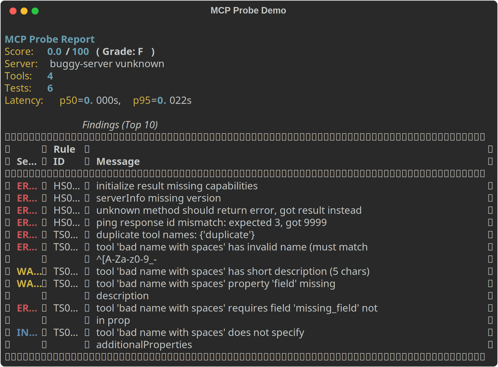

# mcp-probe

Offline conformance & robustness tester for MCP (Model Context Protocol) servers.

## What It Does

`mcp-probe` is a lightweight testing tool that validates MCP server implementations without requiring network access or API keys. It spawns stdio-based MCP servers, checks JSON-RPC handshakes, lints tool schemas, fuzzes tool inputs, and produces a scored report with CI-friendly exit codes.

## Why

As agents increasingly depend on third-party MCP servers for capabilities, there's no easy way to verify that a server actually behaves correctly. Does it handle invalid input gracefully? Are its tool schemas valid? Will it crash under load?

`mcp-probe` answers these questions by running a comprehensive offline test suite against any stdio-based MCP server, catching conformance issues before they affect production agents.

## Features

- **Handshake validation**: Checks `initialize` response structure, protocol version, error codes
- **Tool schema linting**: Validates JSON Schema, naming conventions, required fields, descriptions
- **Schema-driven fuzzing**: Generates valid and invalid inputs from JSON Schema to test error handling
- **Result conformance**: Validates tool call responses match MCP content structure
- **Robustness checks**: Detects crashes, timeouts, stdout noise, high latency
- **Scoring & grading**: 0–100 score with A–F grade based on finding severity
- **Multiple formats**: Table, JSON, Markdown, SARIF-lite output
- **CI integration**: `--fail-under` threshold for automated testing
- **Transcript replay**: Record sessions and check them offline

## Quick Start

```bash
# Install
pip install -e .[dev]

# Test a server
mcp-probe run --cmd "python fixtures/buggy_server.py"

# CI mode with threshold
mcp-probe run --cmd "python my_server.py" --fail-under 80

# JSON output
mcp-probe run --cmd "python my_server.py" --format json --out report.json
```

## Demo



The screenshot above shows `mcp-probe` catching multiple issues in a buggy server: invalid tool names, duplicate entries, missing schema fields, and stdout noise.

## Architecture

```
┌─────────────────────────────────────────────────────────┐
│                      mcp-probe                          │
│                                                         │
│  ┌──────────┐      ┌──────────┐      ┌──────────┐    │
│  │  Client  │─────▶│  Runner  │─────▶│  Report  │    │
│  │ (stdio)  │      │          │      │ (table/  │    │
│  │          │      │          │      │  json/   │    │
│  │          │      │          │      │  md)     │    │
│  └──────────┘      └──────────┘      └──────────┘    │
│       │                  │                             │
│       │                  ▼                             │
│       │            ┌──────────┐                        │
│       │            │   Rules  │                        │
│       │            │          │                        │
│       │            │ Handshake│                        │
│       │            │ Schema   │                        │
│       │            │ Fuzz     │                        │
│       │            │ Results  │                        │
│       │            │ Robustness│                       │
│       │            └──────────┘                        │
│       │                                                │
│       ▼                                                │
│  ┌──────────────────┐                                 │
│  │  MCP Server      │                                 │
│  │  (subprocess)    │                                 │
│  │  stdin/stdout    │                                 │
│  └──────────────────┘                                 │
└─────────────────────────────────────────────────────────┘
```

## Rule Reference

| Rule ID | Category | Description |
|---------|----------|-------------|
| HS001–HS013 | Handshake | Protocol handshake conformance (initialize, ping, error codes, id matching) |
| TS001–TS011 | Tool Schema | Tool schema validation (naming, required fields, JSON Schema validity, descriptions) |
| RS001–RS007 | Results | Tool result conformance (content structure, type checking, outputSchema validation) |
| FZ001–FZ003 | Fuzzing | Invalid input handling (crashes, timeouts, error responses) |
| RB001–RB005 | Robustness | Server stability and performance (alive check, stdout noise, latency) |

## CLI Reference

### `mcp-probe run`

Run conformance tests against a server.

```bash
mcp-probe run \
  --cmd "python server.py" \
  --timeout 5 \
  --seed 1 \
  --fuzz-per-tool 8 \
  --format table \
  --fail-under 80 \
  --out report.json
```

**Options:**
- `--cmd`: Command to launch MCP server (required)
- `--timeout`: Request timeout in seconds (default: 5)
- `--seed`: Random seed for deterministic fuzzing (default: 1)
- `--fuzz-per-tool`: Number of fuzz test cases per tool (default: 8)
- `--format`: Output format: `table`, `json`, `markdown` (default: table)
- `--fail-under`: Exit 1 if score below threshold (optional)
- `--out`: Write report to file (optional)

### `mcp-probe check-transcript`

Check a recorded session offline.

```bash
mcp-probe check-transcript session.jsonl --format json
```

### `mcp-probe rules`

List all probe rules.

```bash
mcp-probe rules
```

### `mcp-probe serve`

Start FastAPI server for HTTP API.

```bash
mcp-probe serve --port 8000
```

**Endpoints:**
- `POST /check-transcript`: Check a transcript (body: `{"transcript": "...jsonl..."}`)
- `GET /rules`: List all rules
- `GET /`: API info

## CI Usage

GitHub Actions example:

```yaml
- name: Install mcp-probe
  run: pip install -e .[dev]

- name: Test MCP server
  run: mcp-probe run --cmd "python server.py" --fail-under 80 --format json --out report.json

- name: Upload report
  uses: actions/upload-artifact@v3
  with:
    name: mcp-probe-report
    path: report.json
```

## Limitations

- **Stdio only**: Currently supports stdio transport; HTTP/SSE support is planned
- **Tool focus**: Tests tool capability; prompts and resources not yet covered
- **Shallow fuzzing**: Generates inputs from schema structure; doesn't understand semantic constraints
- **No auth**: Can't test servers requiring authentication handshakes

## Development

```bash
# Install dev dependencies
pip install -e .[dev]

# Run tests
pytest

# Run with coverage
pytest --cov=mcp_probe --cov-report=term-missing

# Lint
python -m py_compile src/mcp_probe/*.py

# Generate demo
python scripts/make_demo.py
```

## Credits

This project implements a client for the [Model Context Protocol](https://modelcontextprotocol.io/specification/2025-06-18/server/tools) specification and references the [MCP Python SDK](https://github.com/modelcontextprotocol/python-sdk) (MIT License) for protocol details. No code was copied from the SDK.

Trending context (verified 21 Nov 2026):
- GitHub Trending: obra/superpowers, HKUDS/CLI-Anything, cursor/plugins, firecrawl/firecrawl
- Python Trending: Tracer-Cloud/opensre, SWE-agent/mini-swe-agent, wshobson/agents
- Hacker News: OpenComputer (Devin alternative), DreamCoder

## License

MIT License - Copyright (c) 2026 Abhi Raj

See [LICENSE](LICENSE) for details.
