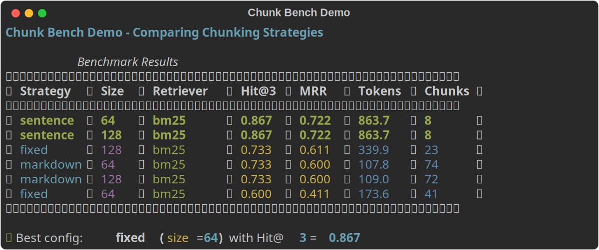

# Chunk Bench

Offline RAG chunking benchmark: converts a Markdown/text corpus into chunks with several strategies (fixed, sentence, recursive, markdown-heading-aware), indexes them with a deterministic fake embedder plus BM25, and scores each strategy on a labelled question set (hit@k, MRR, context precision, token cost) so you can pick a chunking config with evidence and gate it in CI.

## Why This Matters

Everyone converts docs to Markdown (see [markitdown](https://github.com/microsoft/markitdown) and [firecrawl](https://github.com/firecrawl/firecrawl)), but chunking choices are usually guesswork. No tiny offline tool measures them. This benchmark:

- **Runs offline** with no API keys or network calls
- **Uses deterministic embeddings** (hashing trick) for reproducible results
- **Measures multiple strategies** against your actual corpus
- **Provides CI gates** to prevent regressions
- **Shows token costs** to balance quality vs. expense

Perfect for RAG pipelines where you need evidence-backed chunking decisions.

## Quick Start

```bash
# Install
pip install -e .

# Generate evaluation questions from your corpus
chunk-bench synth --corpus ./docs --out questions.jsonl --n 30

# Run benchmark sweep
chunk-bench run \
  --corpus ./docs \
  --questions questions.jsonl \
  --strategy fixed,sentence,recursive,markdown \
  --size 64,128,256 \
  --retriever dense,bm25,hybrid \
  -k 3

# CI gate: fail if best config falls below threshold
chunk-bench run \
  --corpus ./docs \
  --questions questions.jsonl \
  --strategy markdown \
  --size 128 \
  --min-hit-at-k 0.8

# Compare against baseline
chunk-bench run \
  --corpus ./docs \
  --questions questions.jsonl \
  --strategy markdown \
  --size 128 \
  --compare baseline.json \
  --out report.json
```

## Demo



## Chunking Strategies

| Strategy | Description | Best For |
|----------|-------------|----------|
| **fixed** | Fixed token size with overlap | Uniform chunks, simple indexing |
| **sentence** | Group N sentences per chunk | Preserving sentence boundaries |
| **recursive** | Split by separators (\\n\\n, \\n, ., space) | General purpose, respects structure |
| **markdown** | Split by headings, preserve heading hierarchy | Markdown docs with clear sections |

## Metrics

| Metric | Definition | Higher = Better |
|--------|------------|-----------------|
| **Hit@k** | Fraction of queries with relevant chunk in top-k | ✓ |
| **MRR** | Mean reciprocal rank of first relevant chunk | ✓ |
| **Recall@k** | Fraction of relevant chunks retrieved | ✓ |
| **Context Precision** | Fraction of retrieved chunks that are relevant | ✓ |
| **Avg Tokens** | Average tokens retrieved per query | Lower is cheaper |
| **Chunk Count** | Total chunks in index | - |
| **Redundancy** | Overlap duplication ratio | Lower = less waste |

## CLI Reference

```bash
# Run sweep over configurations
chunk-bench run \
  --corpus DIR \
  --questions FILE.jsonl \
  [--strategy fixed,sentence,recursive,markdown] \
  [--size 64,128,256] \
  [--overlap 0,16] \
  [--retriever dense,bm25,hybrid] \
  [-k 3] \
  [--seed 1] \
  [--format table|json|markdown|csv] \
  [--min-hit-at-k 0.8] \
  [--compare baseline.json] \
  [--out report.json]

# Chunk a single file
chunk-bench chunk FILE \
  --strategy markdown \
  --size 128

# Generate synthetic questions
chunk-bench synth \
  --corpus DIR \
  --out questions.jsonl \
  [--n 30] \
  [--seed 1]

# List strategies
chunk-bench strategies

# Start API server
chunk-bench serve --port 8000
```

## FastAPI Endpoints

```bash
# Start server
chunk-bench serve --port 8000

# List strategies
curl http://localhost:8000/strategies

# Evaluate configuration
curl -X POST http://localhost:8000/evaluate \
  -H "Content-Type: application/json" \
  -d '{
    "texts": [{"doc_id": "doc1", "text": "Content here"}],
    "questions": [{"question": "What?", "gold_doc": "doc1", "gold_substring": "Content"}],
    "config": {"strategy": "markdown", "size": 128, "overlap": 0, "retriever": "bm25", "k": 3, "seed": 1}
  }'
```

## GitHub Actions CI Example

```yaml
name: Chunk Quality Gate

on: [push, pull_request]

jobs:
  benchmark:
    runs-on: ubuntu-latest
    steps:
      - uses: actions/checkout@v3
      - uses: actions/setup-python@v4
        with:
          python-version: '3.11'
      
      - name: Install dependencies
        run: |
          cd daily-builds/2026-11-22-chunk-bench
          pip install -e .
      
      - name: Run benchmark
        run: |
          cd daily-builds/2026-11-22-chunk-bench
          chunk-bench run \
            --corpus fixtures/corpus \
            --questions fixtures/questions.jsonl \
            --strategy markdown \
            --size 128 \
            --min-hit-at-k 0.85
```

## Architecture

```
┌─────────────┐
│   Corpus    │  (Markdown/text files)
└──────┬──────┘
       │
       ▼
┌─────────────┐
│  Chunkers   │  (fixed, sentence, recursive, markdown)
└──────┬──────┘
       │
       ▼
┌─────────────┐
│   Chunks    │  (text + offsets + metadata)
└──────┬──────┘
       │
       ▼
┌─────────────┐
│  Embedder   │  (HashEmbedder or pluggable)
└──────┬──────┘
       │
       ▼
┌─────────────┐
│ Retrievers  │  (dense, BM25, hybrid)
└──────┬──────┘
       │
       ▼
┌─────────────┐
│  Questions  │  (labeled eval set)
└──────┬──────┘
       │
       ▼
┌─────────────┐
│   Metrics   │  (hit@k, MRR, precision, tokens)
└─────────────┘
```

## Plugging a Real Embedder

Replace `HashEmbedder` with your production model:

```python
from chunk_bench.models import Chunk
from chunk_bench.retrieve import DenseRetriever
import numpy as np

class OpenAIEmbedder:
    def __init__(self, model="text-embedding-3-small"):
        from openai import OpenAI
        self.client = OpenAI()
        self.model = model
    
    def embed(self, text: str) -> np.ndarray:
        response = self.client.embeddings.create(
            input=text,
            model=self.model
        )
        return np.array(response.data[0].embedding)
    
    def embed_batch(self, texts: list[str]) -> np.ndarray:
        response = self.client.embeddings.create(
            input=texts,
            model=self.model
        )
        return np.array([d.embedding for d in response.data])

# Use it
embedder = OpenAIEmbedder()
retriever = DenseRetriever(embedder)
retriever.index(chunks)
result = retriever.retrieve("query", k=3)
```

## Limitations

- **Hash embedder is lexical, not semantic**: It uses token overlap, not meaning. Good for benchmarking chunking strategies, but use real embeddings in production.
- **English whitespace tokenization**: Assumes space-separated tokens. Non-Latin scripts may need different tokenizers.
- **No re-ranking**: Retrieves once; doesn't model multi-hop or re-ranking.
- **Small corpus focus**: Optimized for documentation (1K-100K chunks), not web-scale.

## Development

```bash
# Install with dev dependencies
pip install -e .[dev]

# Run tests
pytest

# Check coverage
pytest --cov=chunk_bench --cov-report=html

# Generate demo
make demo

# Lint
make lint
```

## Credits

- Inspired by [markitdown](https://github.com/microsoft/markitdown) (MIT, Microsoft) and [firecrawl](https://github.com/firecrawl/firecrawl) for Markdown corpus generation context
- BM25 implementation based on Robertson & Zaragoza, "The Probabilistic Relevance Framework: BM25 and Beyond"
- No code copied; all implementations original

## License

MIT License - Copyright (c) 2026 Abhi Raj

See [LICENSE](LICENSE) for full text.
