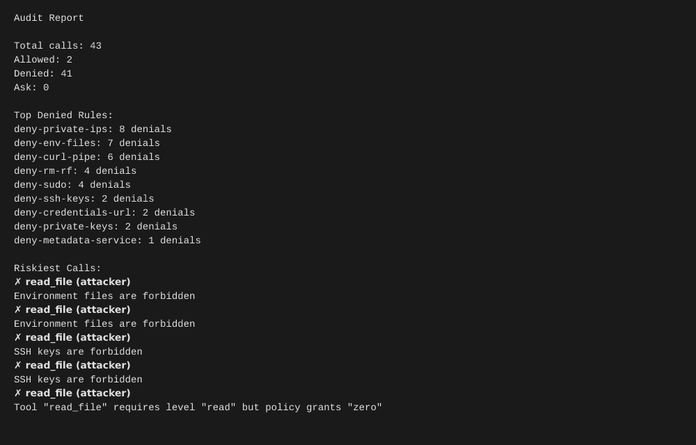

# rwx-guard

Offline permission-policy engine and auditor for AI-agent tool calls, in TypeScript. A small YAML/JSON policy (Unix-style 0/r/w/x levels, glob rules on tool names, paths, hosts and shell commands, argument constraints, rate budgets) decides allow/deny/ask for every tool call.

## Why Now?

The [0rwx framework](https://0rwx.com/) introduces a simple model for AI usage inspired by Unix permissions (zero/read/write/execute). Meanwhile, agent tooling is exploding on GitHub (obra/superpowers, cursor/plugins, mastra-ai/mastra) with agents being handed shells, files, and web access. **What may this agent do?** is the critical question.

rwx-guard turns the 0rwx labelling idea into an **enforceable, testable policy** for agent tool calls.

## Features

- **Four permission levels** (0/r/w/x): `zero < read < write < execute`
- **Policy engine**: YAML/JSON policies with glob patterns, path jailing, host filtering, command parsing, argument constraints
- **Audit replay**: Analyze JSONL tool-call logs, generate reports, suggest least-privilege policies
- **Library + middleware**: `guard.check(call)`, `withGuard(tools, guard)`
- **CLI**: check, audit, lint, init
- **CI gates**: `--fail-on denied`, `--max-denied N`

## Quick Start

```bash
npm ci
npm run build
npx rwx-guard audit --policy fixtures/policy-locked.yaml --log fixtures/calls-risky.jsonl
```

## Demo



*Audit report showing denied dangerous calls*

## Permission Levels

| Level | Description | Typical Tools |
|-------|-------------|---------------|
| `zero` | No access | - |
| `read` | Read-only operations | `read_file`, `list_*`, `search_*` |
| `write` | Modify data | `write_file`, `delete_*`, `create_*` |
| `execute` | Side effects (shell, network) | `shell`, `exec`, `fetch_url` |

Access is **hierarchical**: granting `write` also allows `read` and `zero`.

## Policy File

### Structure

```yaml
version: 1
defaultLevel: read          # Tools default to this level
defaultDecision: deny       # allow, deny, or ask
strict: true                # deny always overrides allow

tools:
  read_*: { level: read }
  write_*: { level: write }
  shell: { level: execute }

rules:
  - id: deny-env-files
    match:
      args:
        - type: path
          pattern: '**/.env*'
    decision: deny
    reason: Environment files are forbidden

budgets:
  - tool: 'shell'
    max: 10
    windowSec: 60
```

### Matching Semantics

**Rules are evaluated in order** (first-match-wins).

**Match criteria** (all must match):
- `tool`: glob pattern (e.g., `read_*`, `shell`)
- `agent`: glob pattern
- `args`: array of matchers (any matcher can match)

**Arg matchers**:
- `path`: glob pattern, workspace jailing, `..` traversal blocking, sensitive file blocking (`**/.env*`, `**/.ssh/*`, `**/id_rsa*`)
- `host`: allow/deny lists, wildcard domains (`*.evil.com`), CIDR (`10.0.0.0/8`), blocks `169.254.169.254`, userinfo URLs
- `command`: deny patterns (`rm -rf /`, `curl*|*sh`, `sudo*`), allow binaries list, detects command injection (`$(...)`, backticks)
- `regex`: match field value with regex
- `numeric`: min/max bounds on numeric fields
- `maxBytes`: string field size limit

**Strict mode**: When `strict: true`, if **any** rule matches with `decision: deny`, the call is denied even if another rule allows it.

## CLI Reference

### `rwx-guard check`

Check a single tool call:

```bash
rwx-guard check --policy policy.yaml --tool shell --args '{"command":"ls"}' [--agent coder] [--explain]
```

Exits 0 (allow), 1 (deny), or 2 (error).

### `rwx-guard audit`

Audit a log of tool calls:

```bash
rwx-guard audit --policy policy.yaml --log calls.jsonl \
  [--format text|json|markdown] \
  [--fail-on denied|ask|none] \
  [--max-denied N] \
  [--suggest out.yaml]
```

Generates a report with:
- Verdict counts (allowed/denied/ask)
- Top denied rules
- Riskiest calls
- Optional least-privilege policy suggestion

### `rwx-guard lint`

Lint a policy file:

```bash
rwx-guard lint policy.yaml [--format text|json]
```

Checks for:
- Shadowed (unreachable) rules
- Missing reasons
- Overly broad allows (`tool: "*"` + `allow`)

Exits 0 (passed) or 1 (issues found).

### `rwx-guard init`

Generate a new policy:

```bash
rwx-guard init [--preset readonly|dev|locked] > policy.yaml
```

### `rwx-guard levels`

Show available permission levels.

## Library Usage

```typescript
import { loadPolicy, createGuard, withGuard, PolicyDeniedError } from 'rwx-guard';

// Create guard
const policy = loadPolicy('policy.yaml');
const guard = createGuard(policy, { 
  clock: () => Date.now(),
  workspaceRoot: '/home/user/project',
  explain: true  // Include decision trace
});

// Check a single call
const decision = guard.check({
  agent: 'coder',
  tool: 'write_file',
  args: { path: 'src/index.ts', content: 'code' },
});

console.log(decision.verdict);  // 'allow', 'deny', or 'ask'
console.log(decision.reason);
console.log(decision.ruleId);

// Wrap tools with middleware
const tools = {
  shell: (args: { command: string }) => execSync(args.command),
  write_file: (args: { path: string; content: string }) => writeFileSync(args.path, args.content),
};

const guardedTools = withGuard(tools, guard, { agent: 'coder' }, {
  onAsk: (decision) => {
    // Handle "ask" verdict
    console.log('Approval required:', decision.reason);
  },
});

try {
  guardedTools.shell({ command: 'rm -rf /' });
} catch (err) {
  if (err instanceof PolicyDeniedError) {
    console.log('Denied:', err.decision.reason);
  }
}
```

## GitHub Actions CI

```yaml
- name: Audit agent tool calls
  run: |
    npx rwx-guard audit \
      --policy .github/agent-policy.yaml \
      --log agent-calls.jsonl \
      --fail-on denied \
      --max-denied 0
```

## Architecture

```
┌─────────────┐
│  Tool Call  │
└──────┬──────┘
       │
       v
┌──────────────────┐
│  createGuard()   │
│  - Load policy   │
│  - Init budgets  │
└──────┬───────────┘
       │
       v
┌──────────────────────┐
│  check()             │
│  1. Budget check     │
│  2. Level check      │
│  3. Rule matching    │
│  4. Redact secrets   │
└──────┬───────────────┘
       │
       v
┌──────────────────┐
│   Decision       │
│  - verdict       │
│  - ruleId        │
│  - reason        │
│  - redactedArgs  │
└──────────────────┘
```

## Threat Model & Limitations

**What it does**:
- Policy-based authorization for tool calls
- Audit and visibility
- Best-effort command parsing and path validation
- Secret redaction in logs

**What it does NOT do**:
- **Not a sandbox**: No OS-level enforcement
- **Command parsing is best-effort**: Complex shell constructs may bypass detection
- **Not a substitute for containers**: Use proper isolation for untrusted code
- **Offline only**: No runtime agent control or remote policy updates

**Assumptions**:
- Agents respect the guard (cooperative security)
- Policies are written and maintained by humans
- Logs are trusted for audit purposes

## Credits & Licenses

- **Inspiration**: [0rwx framework](https://0rwx.com/) (labels CC0 per site) — conceptual framework only, no code copied
- **Dependencies**:
  - `picomatch` (MIT) — glob matching
  - `zod` (MIT) — schema validation
  - `yaml` (ISC) — YAML parsing
  - `commander` (MIT) — CLI framework
  - `picocolors` (ISC) — terminal colors
  - `vitest` (MIT) — testing
  - `@resvg/resvg-js` (MPL-2.0) — SVG to PNG conversion

## Development

```bash
npm ci                  # Install dependencies
npm run build           # Build TypeScript
npm run typecheck       # Type check without emit
npm test                # Run tests with coverage
npm run demo            # Generate docs/demo.png
```

## License

MIT License — Copyright (c) 2026 Abhi Raj

See [LICENSE](LICENSE) for full text.
