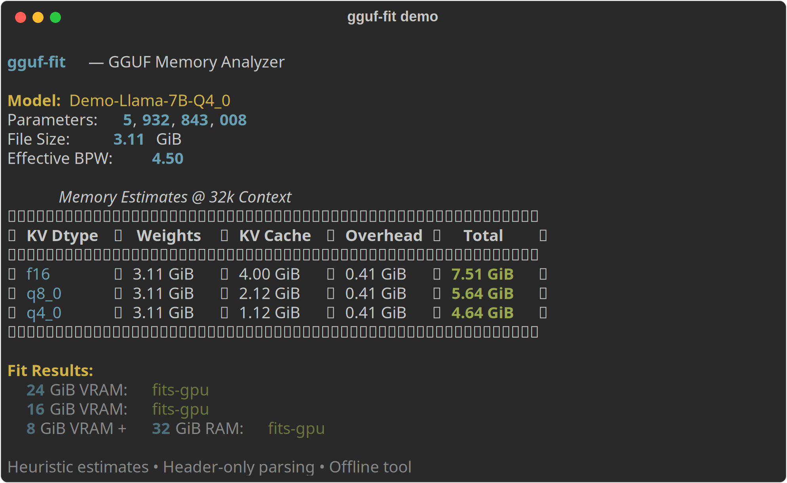

# gguf-fit

Offline Python CLI + library that parses GGUF model files and answers **"Will it fit?"**

Parse GGUF headers (no model weights needed), extract architecture metadata, calculate parameter counts and effective bits-per-weight, estimate memory requirements (weights + KV-cache + overhead), and plan GPU/CPU offload against RAM/VRAM budgets.

## Why?

New open models ship as GGUF quantizations every week. Before downloading 20 GB:
- **Know if it fits** your 24 GiB GPU at 32k context
- **Compare quants** (Q4_0 vs Q8_0) on memory and quality
- **Find max context** your budget allows
- **Plan layer offload** for partial GPU fits

Recent examples:
- [NariQ: BF16-level Qwen3.8-27B in a 10 GB file](https://huggingface.co/nari-labs/Qwen3.8-27B-NariQ-GGUF) (HN front page, 24 Nov 2026)
- [GLM-5.4: First loop transformer](https://z.ai/blog/glm-5.4) (GitHub Trending)

## Quickstart

```bash
pip install -e .

# Generate test fixtures
gguf-fit make-fixture --out /tmp/fx --preset tiny-llama

# Inspect model
gguf-fit inspect /tmp/fx/tiny-llama.gguf

# Check if it fits
gguf-fit fit /tmp/fx/tiny-llama.gguf --vram 24GiB --ctx 32768 --kv q8_0

# Find maximum context
gguf-fit max-ctx /tmp/fx/tiny-llama.gguf --vram 24GiB --kv q8_0

# Compare two models
gguf-fit compare model_q4.gguf model_q8.gguf --ctx 8192
```



## Memory Estimation

Memory usage = **Weights** + **KV Cache** + **Overhead**

### Weights
Sum of all tensor sizes based on quantization type.

### KV Cache
Formula:
```
KV_bytes = 2 × n_layers × n_ctx × n_kv_heads × head_dim × bytes_per_elem
```

Where:
- `2` = key + value
- `n_layers` = transformer blocks
- `n_ctx` = context length
- `n_kv_heads` = KV attention heads (GQA-aware)
- `head_dim` = embedding_length / n_heads
- `bytes_per_elem` depends on KV dtype:
  - `f16`: 2.0 bytes
  - `q8_0`: 1.0625 bytes (34/32)
  - `q4_0`: 0.5625 bytes (18/32)

### Overhead
Heuristic: **5% of weights + 256 MiB** (configurable)

Accounts for compute buffers, graph overhead, etc. Real runtimes vary ±few%.

### Worked Example

**Llama-style model:**
- 32 layers
- 32 heads, 8 KV heads (GQA)
- 4096 embedding length → head_dim = 128
- Context: 32,768
- KV dtype: f16

```
KV_f16 = 2 × 32 × 32768 × 8 × 128 × 2
       = 4,294,967,296 bytes
       = 4.00 GiB
```

With `q8_0` KV cache:
```
KV_q8 = 2 × 32 × 32768 × 8 × 128 × (34/32)
      = 4,563,402,752 bytes
      = 4.25 GiB
```

## CLI Reference

### `gguf-fit inspect`
```bash
gguf-fit inspect model.gguf [--tensors] [--format text|json|markdown]
```
Show architecture, parameter count, quantization mix, effective bpw.

### `gguf-fit fit`
```bash
gguf-fit fit model.gguf \
  --vram 24GiB \
  [--ram 32GiB] \
  [--ctx 32768] \
  [--kv f16|q8_0|q4_0] \
  [--parallel 1] \
  [--fail-if-over] \
  [--format text|json]
```
Check if model fits. Verdict: `fits-gpu`, `partial-offload`, `cpu-only`, `does-not-fit`.

Exit codes (with `--fail-if-over`):
- **0**: fits
- **1**: doesn't fit
- **2**: parse/usage error

### `gguf-fit max-ctx`
```bash
gguf-fit max-ctx model.gguf --vram 24GiB [--kv q8_0]
```
Binary search to find largest context that fits budget.

### `gguf-fit compare`
```bash
gguf-fit compare a.gguf b.gguf --ctx 8192 [--format text|json]
```
Side-by-side comparison (size, bpw, memory, type diff).

### `gguf-fit make-fixture`
```bash
gguf-fit make-fixture --out tests/fixtures --preset tiny-llama|tiny-moe
```
Generate synthetic GGUF test files.

## Library Usage

```python
from gguf_fit import read_gguf, estimate, plan_fit, max_context

# Read model header (no weights loaded)
m = read_gguf('model.gguf')

# Estimate memory
est = estimate(m, ctx=32768, kv='q8_0', parallel=1)
print(f"Total memory: {est.total_bytes / 2**30:.2f} GiB")

# Plan GPU/CPU fit
plan = plan_fit(m, vram='24GiB', ram='32GiB', ctx=32768, kv='q8_0')
print(f"Verdict: {plan.verdict}")
print(f"GPU layers: {plan.gpu_layers}")

# Find max context
max_ctx = max_context(m, vram='24GiB', kv='q8_0')
print(f"Max context: {max_ctx:,}")
```

## CI Usage

```yaml
- name: Check model fit
  run: |
    pip install gguf-fit
    gguf-fit fit model.gguf --vram 24GiB --ctx 32768 --fail-if-over
```

Exit code 1 if model doesn't fit → CI fails.

## Architecture

```
GGUF File
│
├─ Header (magic, version, counts)
├─ Metadata KV (architecture, layers, heads, ctx, vocab, rope, ...)
├─ Tensor Info Table (name, dims, type, offset) ← WE READ THIS
│
└─ Tensor Data (actual weights) ← WE SKIP THIS
```

**Header-only parsing:**
- Read magic, version, metadata, tensor table
- **Never** load tensor data → fast, low memory
- Guards: max string/array/tensor limits (survive corrupt/hostile files)

**Planner:**
- Estimate per-layer weight sizes (heuristic split)
- Binary search to fit layers within GPU budget
- KV cache + overhead stay on GPU
- Remaining layers offload to RAM

**Max-context solver:**
- Binary search: find largest ctx where `plan_fit(ctx) != does-not-fit`
- Property: `fits(result)` and `!fits(result+1)`

## Limitations

- **Heuristic overhead:** Real runtimes vary by implementation, batch size, sequence length. This tool gives ±few% estimates.
- **Header-only:** Cannot detect corrupt tensor data (checksums not in GGUF v2/v3 spec).
- **Offload planner:** Rough per-layer split; actual optimal split depends on tensor shapes and runtime.
- **KV cache formula:** Assumes standard attention; exotic architectures (e.g., multi-resolution KV) may differ.

For precise measurements, benchmark with your inference engine (llama.cpp, vLLM, etc.).

## Credits

- **GGUF format spec:** [ggml/docs/gguf.md](https://github.com/ggml-org/ggml/blob/master/docs/gguf.md) (MIT)
- **llama.cpp:** [ggml-org/llama.cpp](https://github.com/ggml-org/llama.cpp) (MIT) — format reference only, no code copied
- **Context:** Hacker News front page (NariQ GGUF, 24 Nov 2026), GitHub Trending (SWE-agent, markitdown)

## License

MIT © 2026 Abhi Raj

No secrets, no real model weights, all offline.
