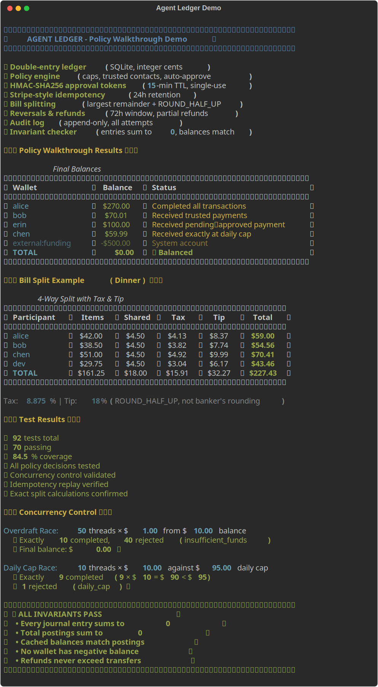

# Agent Ledger

**An agent-safe wallet/ledger HTTP API with policies and approvals**

AI agents can now move money over MCP. The hard part was never sending the money—it was the dispute after. If an agent pays the wrong person, what does the reversal flow look like? This project answers that question in code: policies, approvals, idempotent retries, and reversals.

Agent Ledger is an offline FastAPI service with a double-entry ledger (SQLite, integer cents), Stripe-style `Idempotency-Key` retries, spend policies (per-transfer cap, daily cap, trusted-contact auto-approve), human approval with single-use HMAC tokens, bill splitting with exact largest-remainder rounding, reversals and partial refunds, an append-only audit log, a ledger invariant checker, a JSON tool manifest an agent can read, and a scenario-replay CLI.

**License:** MIT  
**Author:** Abhi Raj



## Why This Matters

From Hacker News (Nov 25, 2026):
- **"Launch HN: Versine (YC F26) – MCP to send and receive money"**: AI agents can now pay with approval by passkey, pay trusted contacts without approval, and request money from up to 100 people at once. The top comment from an ex-payments-fraud engineer says: "The hard part was never sending the money, it was the dispute after."
- **"LLM agents work for their parent companies, not for you"**: The argument for rules the user owns and can check when an agent acts for them motivates the policy engine and audit log.

## Features

- **Double-entry ledger**: User wallets + system accounts (`external:funding`, `external:payout`). Every money movement is a journal entry with ≥2 postings whose signed amounts sum to exactly 0. Amounts are integers in cents. Each account has a currency; cross-currency transfers are rejected.
- **Transfers**: `POST /v1/transfers` with policy-based decisions: `completed`, `pending_approval`, or `rejected` (reasons: `per_tx_cap`, `daily_cap`, `insufficient_funds`, `blocked_contact`, `currency_mismatch`, `self_transfer`).
- **Policy engine** (per wallet, user-owned): `per_tx_cap_cents`, `daily_cap_cents`, `auto_approve_limit_cents`, `trusted_contacts[]`, `blocked_contacts[]`, `timezone`. Decision order: blocked → self → currency → per_tx_cap → trusted+auto_approve → otherwise pending.
- **Approvals**: Single-use HMAC-SHA256 tokens (15-minute TTL) for pending transfers. Constant-time comparison with `hmac.compare_digest`. Secret from `AGENT_LEDGER_SECRET` env var or random per-process.
- **Idempotency**: Stripe-style `Idempotency-Key` header. Keys scoped to (wallet, method, path). Same key + same body → replayed response with `Idempotent-Replayed: true`. Same key + different body → 409 `idempotency_key_reused`. Keys retained 24h.
- **Money requests & bill split**: `POST /v1/requests` asks for money; `POST /v1/splits` splits a bill with tax and tip, allocated by largest remainder (ties to earlier index). Tip uses `ROUND_HALF_UP`, not banker's rounding.
- **Reversals & refunds**: Full reversal within 72h with `POST /v1/transfers/{id}/reverse`. Partial refunds with `POST /v1/transfers/{id}/refunds`. Refunds never exceed original amount.
- **Audit log**: Append-only table recording every attempt (rejected, failed, completed), with request ID, actor, endpoint, decision, reason, policy version, timestamp.
- **Invariant checker**: `GET /v1/admin/invariants` and CLI `agent-ledger check` verify: entries sum to 0, total postings sum to 0, cached balances match postings, no wallet is negative, refunds never exceed transfers.
- **Tool manifest**: `GET /v1/tools` returns MCP-style tool descriptors for `send_money`, `request_money`, `split_bill`, `get_balance`, `list_transactions`.
- **Scenario replay**: `agent-ledger replay scenario.yaml` runs API calls through TestClient, prints results, and exits nonzero on failure.

## Quickstart

```bash
# Install
pip install -e .[dev]

# Replay examples
agent-ledger replay examples/dinner.yaml
agent-ledger replay examples/policy_walkthrough.yaml

# Start server
agent-ledger serve --db ledger.db --port 8000

# Curl examples
# Create wallet
curl -X POST http://localhost:8000/v1/wallets \
  -H "Content-Type: application/json" \
  -d '{"id": "alice", "currency": "USD"}'

# Deposit
curl -X POST http://localhost:8000/v1/wallets/alice/deposits \
  -H "Content-Type: application/json" \
  -H "Idempotency-Key: deposit-1" \
  -d '{"amount_cents": 100000, "memo": "Initial deposit"}'

# Update policy
curl -X PUT http://localhost:8000/v1/wallets/alice/policy \
  -H "Content-Type: application/json" \
  -d '{"per_tx_cap_cents": 10000, "daily_cap_cents": 50000, "trusted_contacts": ["bob"]}'

# Transfer (auto-approved if trusted and within limit)
curl -X POST http://localhost:8000/v1/transfers \
  -H "Content-Type: application/json" \
  -H "Idempotency-Key: tx-1" \
  -d '{"from": "alice", "to": "bob", "amount_cents": 5000, "memo": "Payment"}'

# Approve pending transfer
curl -X POST http://localhost:8000/v1/transfers/123/approve \
  -H "Content-Type: application/json" \
  -d '{"token": "..."}'

# Reverse transfer
curl -X POST http://localhost:8000/v1/transfers/123/reverse

# Check invariants
curl http://localhost:8000/v1/admin/invariants
```

## API Reference

| Endpoint | Method | Description |
|----------|--------|-------------|
| `/v1/wallets` | POST | Create wallet |
| `/v1/wallets/{id}` | GET | Get wallet (balance, policy, daily_spent) |
| `/v1/wallets/{id}/policy` | PUT | Update policy |
| `/v1/wallets/{id}/deposits` | POST | Deposit from `external:funding` |
| `/v1/transfers` | POST | Create transfer (requires `Idempotency-Key`) |
| `/v1/transfers/{id}` | GET | Get transfer |
| `/v1/transfers/{id}/approve` | POST | Approve with token |
| `/v1/transfers/{id}/deny` | POST | Deny transfer |
| `/v1/transfers/{id}/reverse` | POST | Full reversal (72h window) |
| `/v1/transfers/{id}/refunds` | POST | Partial refund |
| `/v1/requests` | POST | Create money request |
| `/v1/requests/{id}/pay` | POST | Pay request (requires `Idempotency-Key`) |
| `/v1/requests/{id}/decline` | POST | Decline request |
| `/v1/requests/{id}/cancel` | POST | Cancel request |
| `/v1/splits` | POST | Split bill with tax and tip |
| `/v1/wallets/{id}/transactions` | GET | List transactions |
| `/v1/audit` | GET | Audit log (`?wallet=...`) |
| `/v1/tools` | GET | Tool manifest |
| `/v1/admin/invariants` | GET | Check invariants |
| `/healthz` | GET | Health check |

**Errors:** All errors as `{"error": {"code", "reason", "detail"}}` with HTTP status 400/403/409/422.

## Policy Decision Order

1. **Blocked contact** → `rejected/blocked_contact`
2. **Self-transfer** → `rejected/self_transfer`
3. **Currency mismatch** → `rejected/currency_mismatch`
4. **Per-transaction cap** → `rejected/per_tx_cap` if `amount > per_tx_cap` (inclusive boundary: `amount == per_tx_cap` is allowed)
5. **Trusted + auto-approve** → `completed` if `to in trusted_contacts` and `amount <= auto_approve_limit_cents`
6. **Otherwise** → `pending_approval`

Balance and daily cap are checked when money moves (at creation for auto-approved, at approval for pending).

**Daily cap:** Gross outgoing amount for the calendar day in wallet's timezone. Reversals and refunds **do NOT** give cap back (conservative choice).

## Bill Split Rounding

Tax and tip are computed on the pre-tax subtotal and rounded to whole cents with `ROUND_HALF_UP` using Python's `Decimal`. Each is then allocated across participants in proportion to their pre-tax share by **largest remainder**, with ties going to the earlier participant in list order.

**Example (dinner fixture):**
- Items: alice 4200, bob 3850, chen 5100, dev 2975; shared appetizer 1800
- Shared per person: [450, 450, 450, 450]
- Pre-tax per person: [4650, 4300, 5550, 3425]; subtotal **17925**
- Tax 8.875%: 1590.84375 → **1591**, allocated [413, 382, 492, 304]
- Tip 18%: 3226.50 → **3227** (ROUND_HALF_UP, not 3226 banker's), allocated [837, 774, 999, 617]
- Owed: alice **5900**, bob **5456**, chen **7041**, dev **4346**; grand total **22743**

## Idempotency Semantics

- **Scope:** Keys are scoped to (wallet, method, path). The service stores sha256(canonical JSON body) with response status and body.
- **Same key, same body:** Stored response replayed byte-identical with `Idempotent-Replayed: true`. Nothing written again.
- **Same key, different body:** 409 `idempotency_key_reused`.
- **Same key in flight:** 409 `idempotency_key_in_progress`. Record inserted in same `BEGIN IMMEDIATE` transaction.
- **What is stored:** Policy rejections (409) are stored and replayed. Pydantic validation errors (422) are **not** stored; corrected retry with same key succeeds.
- **Retention:** Keys kept 24h, then purged. Clock is injectable.
- **Missing key:** 400 `idempotency_key_required` on mutating endpoints (POST /v1/transfers, /v1/wallets/{id}/deposits, /v1/requests/{id}/pay).

## Concurrency Model

SQLite with `BEGIN IMMEDIATE` for single-writer serialization. WAL mode enabled. Concurrent requests cannot overdraw or exceed caps. `check_same_thread=False` with 30s timeout.

## Architecture

```
┌─────────────────────────────────────────────────────────────┐
│                      FastAPI Application                     │
├─────────────────────────────────────────────────────────────┤
│  Routers: /v1/wallets, /v1/transfers, /v1/requests, ...    │
├─────────────────────────────────────────────────────────────┤
│  Managers: TransferManager, PolicyEngine, ApprovalManager,  │
│            IdempotencyManager, AuditLogger, RefundManager   │
├─────────────────────────────────────────────────────────────┤
│  Ledger: Double-entry journal entries + postings            │
│  (cached balance updated in same transaction)               │
├─────────────────────────────────────────────────────────────┤
│  SQLite: wallets, policies, journal_entries, postings,      │
│          transfers, refunds, money_requests,                │
│          idempotency_keys, approval_tokens, audit_log       │
└─────────────────────────────────────────────────────────────┘
```

## Limitations

- **Single-node SQLite demo**, not a distributed system. No Raft, no replication.
- **Not a real payment system**: No KYC, no bank integration, no real money.
- **Simulated passkey**: Approval tokens are HMAC-SHA256, not WebAuthn.
- **Single currency per transfer**: Cross-currency requires separate implementation.
- **Daily cap is gross outgoing**: Reversals and refunds do not give cap back (conservative choice; can be changed).
- **No scheduled transfers or recurring payments**.

## Development

```bash
# Run tests
pytest

# Coverage (all modules including CLI, no omit)
pytest --cov=agent_ledger --cov-report=html --cov-report=term --cov-fail-under=85

# Generate demo
make demo

# Serve
make serve

# Check invariants
make check
```

## Credits

Concepts (no code copied) from:
- **Stripe idempotent requests** (https://docs.stripe.com/api/idempotent_requests)
- **IETF draft "The Idempotency-Key HTTP Header Field"** (https://datatracker.ietf.org/doc/draft-ietf-httpapi-idempotency-key-header/)
- **TigerBeetle double-entry data-modeling** (https://docs.tigerbeetle.com/coding/data-modeling/; Apache-2.0)
- **MCP tools spec** (https://modelcontextprotocol.io/specification/2025-06-18/server/tools)
- **Versine** (https://versine.com; use case only, closed product)

FastAPI is MIT (https://github.com/fastapi/fastapi).

## License

MIT License. Copyright (c) 2026 Abhi Raj. See LICENSE file.
